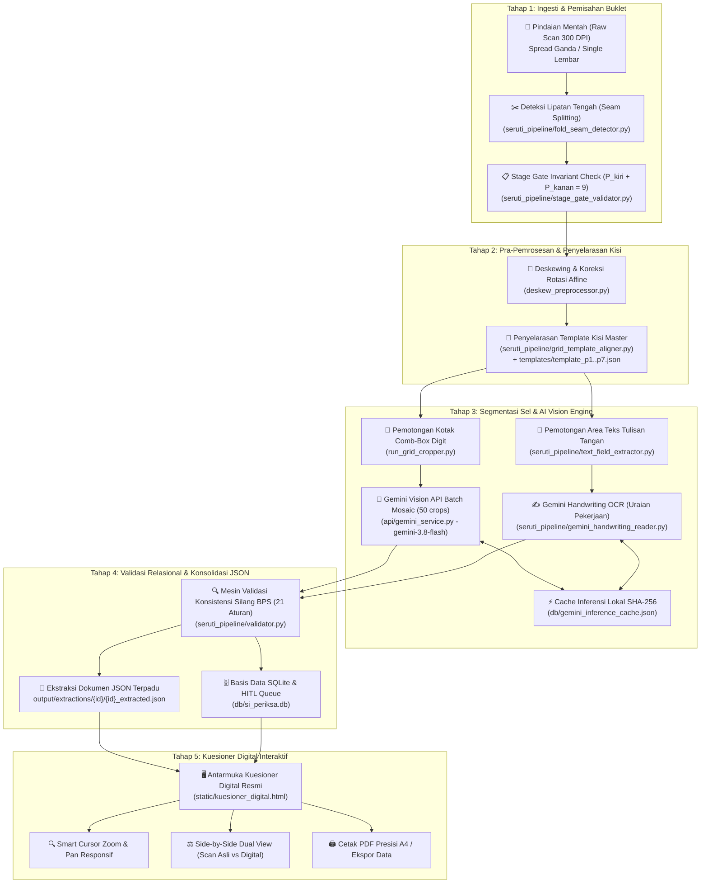

# Alur Kerja End-to-End PindaiSurvei v2.0
### Dari Pindaian Mentah (*Raw Scan*) hingga Kuesioner Digital & Ekstraksi JSON (Disertai Gambar Output Setiap Tahapan)

Dokumen ini memaparkan dokumentasi visual dan arsitektur teknis sistem **PindaiSurvei / Si-Periksa v2.0** (BPS Kabupaten Penajam Paser Utara) dalam mengonversi pindaian fisik dokumen survei (Seruti Inti `VSERUTI26.INTI`, Seruti MAK `VSERUTI26.MAK`, dan Susenas `VSEN26.KP`) menjadi kuesioner digital terverifikasi dan basis data JSON terstruktur.

---

## 1. Diagram Alur Keseluruhan (*Pipeline Architecture*)



---

## 2. Galeri Visual Output Nyata Setiap Tahapan

---

### Tahap 1: Ingesti Citra Mentah (*Raw Document Ingestion & Seam Split*)
Pindaian diterima langsung dari scanner ADF berkecepatan tinggi dengan resolusi kedinasan **300 DPI**. Citra mentah dapat berupa format *spread* (2 halaman A4 dalam 1 pindaian landscape A3).
- **Proses**: Algoritma `seruti_pipeline/fold_seam_detector.py` mendeteksi lipatan tengah ($x \approx 2.480\text{ px}$) dan memisahkannya menjadi halaman tunggal.
- **Validasi**: `seruti_pipeline/stage_gate_validator.py` memverifikasi rumus invarian halaman berpasangan ($P_{\text{kiri}} + P_{\text{kanan}} = 9$).

> **Hasil Output**: Lembar halaman tunggal A4 (misal `hal_1_raw.jpg`) dengan orientasi tegak dan siap diproses oleh modul deskewing.

---

### Tahap 2: Pra-Pemrosesan Citra & Penyelarasan Kisi (*Deskewing & Lattice Grid Snapping*)
1. **Koreksi Kemiringan (*Deskewing*)**: Modul `deskew_preprocessor.py` menghitung sudut kemiringan dokumen menggunakan Transformasi Hough & proyeksi profil, lalu memutar citra balik dengan interpolasi affine.
2. **Penyelarasan Kisi (*Lattice Alignment*)**: Modul `seruti_pipeline/grid_template_aligner.py` mencocokkan garis pembatas blok fisik kertas dengan template koordinat JSON master (`templates/template_p1.json` s.d. `template_p7.json`).

> **Hasil Output**: Citra dokumen lurus sempurna dengan seluruh sel comb-box dan field teks terpetakan ke koordinat bounding box piksel acuan.

---

### Tahap 3: Segmentasi Sel & Inferensi AI Vision (*Cropping & Gemini 3.8-Flash Vision*)
1. **Pemotongan Comb-Box**: `run_grid_cropper.py` memotong setiap kotak angka individu (~$60 \times 75\text{ px}$) dan membersihkan garis tepi (*inner padding*).
2. **Batch Mosaik Grid**: Modul `api/gemini_service.py` menggabungkan hingga 50 crop digit ke dalam satu citra mosaik berindeks (`00` s.d. `49`). API Google Gemini Vision (`gemini-3.8-flash`) mengekstrak seluruh sel dalam satu pemanggilan cepat (<13 detik untuk 510 digit per buklet).
3. **Ekstraksi Tulisan Tangan (*Handwriting OCR*)**: Modul `seruti_pipeline/gemini_handwriting_reader.py` membaca teks uraian pekerjaan terbuka pada Blok V (misal: *"MELAKUKAN PEKERJAAN TUKANG BANGUNAN"*).
4. **Cache Lokal Terenkripsi**: Nilai hash SHA-256 disimpan di `db/gemini_inference_cache.json` untuk mencegah panggilan API berulang.

> **Hasil Output**: Daftar digit dan teks dengan confidence score per sel, tersimpan ke cache inferensi lokal.

---

### Tahap 4: Mesin Validasi Relasional Silang & Ekstraksi JSON (*Cross-Validation Matrix & JSON*)
1. **Validasi Konsistensi Logika BPS**: Modul `seruti_pipeline/validator.py` mengevaluasi 21 relasi konsistensi silang antar-blok kuesioner:
   - Validasi jumlah anggota rumah tangga Blok IV vs baris di Blok V.
   - Pengecekan status penguasaan bangunan R405 (`1` = Milik Sendiri).
   - Validasi kelogisan rasio pengeluaran makanan sebulan terhadap triwulan.
   - Rumus mutasi penambahan vs pengurangan aset ($A_{\text{tambah}} - A_{\text{kurang}} = \Delta A$).
2. **Penyusunan Format JSON Terpadu**: Disimpan otomatis di `output/extractions/{booklet_id}/{booklet_id}_extracted.json`.

#### Cuplikan JSON Hasil Ekstraksi:
```json
{
  "booklet_id": "booklet_01",
  "survey_type": "seruti_inti",
  "metadata": {
    "nks": "42 / 01",
    "nus": "01",
    "nama_krt": "ARBAIN"
  },
  "b1": {
    "prov": "64", "kab": "09", "kec": "010", "desa": "002", "sls": "0001"
  },
  "b2": {
    "triwulan": "2",
    "kesediaan": "1"
  },
  "b42a": {
    "r405": "1"
  },
  "b5_r501": [
    {
      "no_art": "1",
      "uraian": "MELAKUKAN PEKERJAAN TUKANG BANGUNAN",
      "kbli": "11",
      "jenis_pekerjaan": "9",
      "upah_uang": 7500000,
      "upah_barang": 0,
      "lembur": 0
    },
    {
      "no_art": "3",
      "uraian": "SECURITY DI KANTOR PEMERINTAHAN IKN",
      "kbli": "20",
      "jenis_pekerjaan": "5",
      "upah_uang": 13500000,
      "upah_barang": 540000,
      "lembur": 4500000
    }
  ],
  "validation_metrics": {
    "rules_passed": 17,
    "warnings": 4,
    "fatal_errors": 0,
    "confidence_mean": 0.9872
  }
}
```

---

### Tahap 5: Penyajian Kuesioner Digital Resmi (*Interactive Digital Questionnaire*)
Modul antarmuka `static/kuesioner_digital.html` merender dokumen digital yang 100% identik dengan formulir cetak fisik BPS:
1. **Pemetaan Variabel Otomatis**: Angka diformat mata uang dengan pemisah ribuan rupiah, status bangunan R405 terisi kode `1`, dan uraian pekerjaan menampilkan teks tulisan tangan asli (bukan lagi kode KBLI placeholder).
2. **Smart Cursor Zoom & Pan**: Pembesaran mulus terfokus dinamis mengikuti koordinat kursor mouse pengguna untuk verifikasi cepat.
3. **Dual-View / Split Screen**: Peninjauan dokumen digital berdampingan langsung dengan pindaian dokumen fisik asli.
4. **Cetak & Ekspor**: Cetak standar A4 siap pakai kedinasan dan ekspor JSON bersih.
