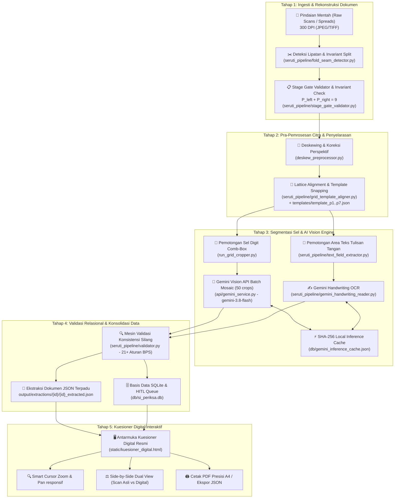

# Alur Kerja End-to-End PindaiSurvei v2.0
### Dari Pindaian Mentah (*Raw Scan*) hingga Kuesioner Digital & Ekstraksi JSON

Dokumen ini memaparkan arsitektur alur kerja (*pipeline*) komprehensif sistem **PindaiSurvei / Si-Periksa v2.0** (BPS Kabupaten Penajam Paser Utara) dalam memproses dokumen kuesioner kertas fisik survei resmi (Seruti Inti `VSERUTI26.INTI`, Seruti MAK `VSERUTI26.MAK`, dan Susenas `VSEN26.KP`).

---

## 1. Diagram Alur Keseluruhan (*High-Level Architecture*)

---

## 2. Rincian Tahapan Alur Kerja (*Step-by-Step Breakdown*)

### Tahap 1: Ingesti & Rekonstruksi Buklet (*Document Ingestion & Assembly*)
1. **Penerimaan Citra Mentah**:
   - Pindaian dokumen kuesioner diterima dari scanner berkas berkecepatan tinggi (ADF) beresolusi standar kedinasan **300 DPI**.
   - Berkas dapat berformat *spread* (2 halaman A4 berdampingan dalam satu scan A3/Landscape) atau lembar tunggal.
2. **Pemisahan Lipatan (*Fold Seam Detection*)**:
   - Dijalankan oleh `seruti_pipeline/fold_seam_detector.py`.
   - Algoritma memindai proyeksi intensitas vertikal pada kuadran tengah citra ($x \approx 2.480\text{ px}$) untuk mendeteksi bayangan lekukan lipatan kertas atau staples, lalu membelah citra menjadi halaman kiri dan kanan.
3. **Pemeriksaan Invarian Nomor Halaman (*Invariant Page Sum Check*)**:
   - Divalidasi oleh `create_seruti_inti_booklets.py` dan `seruti_pipeline/stage_gate_validator.py`.
   - Untuk Seruti Inti 8 halaman, kombinasi pasangan spread wajib memenuhi invarian:
     $$P_{\text{left}} + P_{\text{right}} = 9$$
     *(Contoh: Spread 0 = Hal 4 & 5; Spread 1 = Hal 6 & 3; Spread 2 = Hal 2 & 7; Spread 3 = Hal 8 & 1)*.
   - Dokumen yang lolos diberi status `PROCEED_TO_OCR`. Jika ada halaman tertukar atau terbalik, sistem menandai `FLAG_FOR_HITL_REVIEW`.

---

### Tahap 2: Pra-Pemrosesan Citra & Penyelarasan Kisi (*Preprocessing & Alignment*)
1. **Koreksi Kemiringan (*Deskewing*)**:
   - Dijalankan oleh `deskew_preprocessor.py`.
   - Menggunakan Transformasi Hough (*Probabilistic Hough Transform*) dan analisis proyeksi profil horizontal untuk mendeteksi sudut kemiringan dokumen ($\theta$). Citra dirotasi balik (*affine rotation*) dengan interpolasi kubik agar garis kisi tabel sejajar sempurna secara horizontal dan vertikal.
2. **Penyelarasan Template Kisi (*Lattice Grid Snapping*)**:
   - Dijalankan oleh `seruti_pipeline/grid_template_aligner.py` merujuk pada template master JSON:
     * Hal 1: `templates/template_p1.json` (KOP, Identitas Wilayah, Triwulan)
     * Hal 2: `templates/template_p2.json` (Roster ART, Status Bangunan R405)
     * Hal 3-7: `templates/template_p3.json` s.d. `templates/template_p7.json` (Pengeluaran, Pendapatan Blok V, Aset Blok VI, Keuangan Blok VII)
   - Sistem mencari titik jangkar sudut (*anchor corners*) dan garis pembatas terluar blok kuesioner, lalu melakukan penskalaan koordinat (*homography transform*) agar bounding box sel digital menempel presisi pada kotak fisik di kertas.

---

### Tahap 3: Segmentasi Sel & Mesin Inferensi AI Vision (*Cropping & AI Vision Engine*)
1. **Pemotongan Kotak Comb-Box Digit**:
   - Modul `run_grid_cropper.py` mengekstrak setiap kotak karakter satu per satu (ukuran rata-rata $60 \times 75\text{ px}$).
   - Garis batas comb-box dibersihkan (*inner padding cropping*) agar menyisakan goresan tinta pensil/pulpen saja.
2. **Pemotongan Area Teks Tulisan Tangan**:
   - Modul `seruti_pipeline/text_field_extractor.py` memotong baris teks terbuka (tanpa comb-box) seperti:
     * Blok I: Nama Kepala Rumah Tangga, Alamat/SLS, Nama Petugas & Pengawas.
     * Blok V: Uraian Lapangan Pekerjaan (R501 Kolom 2) & Uraian Kegiatan Usaha (R502 Kolom 2).
3. **Pembacaan Cerdas via Google Gemini Vision API (`gemini-3.8-flash`)**:
   - **Batch Mosaic Grid (Digit)**: `api/gemini_service.py` menggabungkan hingga 50 crop digit ke dalam satu citra kisi mosaik berindeks (`00` s.d. `49`). Satu kali pemanggilan API langsung membaca 50 sel sekaligus. Satu buklet berisi ~510 digit comb-box selesai diekstraksi hanya dalam waktu **10–13 detik** dengan tingkat akurasi >98,7%.
   - **Handwriting OCR (Teks Uraian)**: `seruti_pipeline/gemini_handwriting_reader.py` membaca teks tulisan tangan latin bahasa Indonesia dengan *prompt* kontekstual kedinasan BPS (*contoh hasil: `"MELAKUKAN PEKERJAAN TUKANG BANGUNAN"`, `"SECURITY DI KANTOR PEMERINTAHAN IKN"`*).
4. **Cache Inferensi Lokal Terenkripsi (Zero-Cloud-Egress)**:
   - Setiap crop dihitung nilai hash SHA-256 miliknya. Hasil inferensi disimpan di `db/gemini_inference_cache.json`. Jika sel kosong atau angka yang sama muncul kembali, sistem langsung mengambil dari cache tanpa memanggil API ke cloud.

---

### Tahap 4: Mesin Validasi Silang & Ekstraksi JSON (*Cross-Validation & Export*)
1. **Aturan Konsistensi Silang BPS**:
   - Dijalankan oleh `seruti_pipeline/validator.py` yang menerapkan 21 aturan validasi logika:
     * **REL_01**: Konsistensi jumlah ART di Blok IV terhadap jumlah baris di Roster Blok V.
     * **REL_03**: Validasi nilai pengeluaran makanan sebulan dikalikan 3 terhadap triwulan.
     * **REL_08**: Validasi R405 status penguasaan bangunan tempat tinggal (`1` = Milik Sendiri, `2` = Kontrak, dsb.).
     * **REL_18**: Rumus keseimbangan mutasi aset penambahan vs pengurangan ($A_{\text{tambah}} - A_{\text{kurang}} = \Delta A$).
     * **REL_20 / REL_21**: Saldo penerimaan dan pengeluaran bukan konsumsi serta kelogisan pendapatan kepemilikan.
2. **Penyusunan Format JSON Terpadu**:
   - Seluruh nilai variabel yang telah tervalidasi dirangkum ke dalam satu berkas JSON standar:  
     `output/extractions/{booklet_id}/{booklet_id}_extracted.json`.
3. **Penyimpanan ke Basis Data Lokal**:
   - Mengisi tabel `booklets`, `page_inferences`, dan antrean pemeriksaan `hitl_queue` pada `db/si_periksa.db`.

---

### Tahap 5: Penyajian Kuesioner Digital (*Digital Questionnaire Rendering*)
1. **Render Visual Kuesioner Resmi BPS**:
   - Ditampilkan melalui modul antarmuka web modern `static/kuesioner_digital.html`.
   - Menggunakan tata letak grid dan flexbox A4 proporsional yang persis meniru format fisik buku kertas aslinya (Halaman 1 KOP, Halaman 2 Roster ART & Konsumsi, Halaman 5 Pendapatan, Halaman 6 Transfer & Aset, Halaman 7 Keuangan & Catatan).
2. **Sinkronisasi Field Otomatis**:
   - Fungsi `applyExtractedData()` memetakan data JSON langsung ke input formulir:
     * Angka diformat otomatis dengan pemisah ribuan rupiah (`7.500.000`).
     * R405 terisi kode status bangunan (`1` = Milik Sendiri).
     * Uraian pekerjaan menampilkan teks tulisan tangan asli hasil bacaan Gemini.
3. **Fitur Pemeriksaan Lanjutan**:
   - **Smart Cursor Zoom & Pan**: Kuesioner memperbesar area tabel secara mulus (*smooth scaling*) berpusat pada posisi kursor mouse pemeriksa.
   - **Mode Buku & Sorotan Isian**: Mengubah tampilan menjadi mode dua halaman (*booklet spread*) dan menyorot sel-sel yang diisi data.
   - **Dual-View Overlay**: Membuka pindaian dokumen asli bersebelahan dengan kuesioner digital untuk verifikasi manual instan.
   - **Cetak Presisi & Ekspor**: Tombol ekspor JSON dan cetak format kertas A4 kedinasan.
