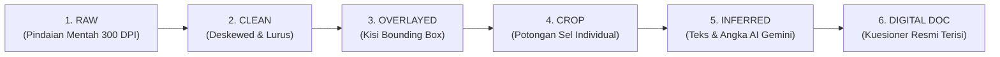

# Siklus Transformasi Dokumen: Raw ke Kuesioner Digital
### Panduan Visual Perubahan Wujud Dokumen Survei PindaiSurvei v2.0 (BPS Kab. PPU)

Dokumen ini memaparkan evolusi fisik citra dokumen (*document image lifecycle*) dari saat pertama kali dipindai scanner hingga menjadi kuesioner digital resmi yang terisi penuh.

---

## 1. Peta Evolusi Dokumen

---

## 2. 6 Fase Transformasi Wujud Dokumen

### Fase 1: RAW (Pindaian Dokumen Fisik Asli)
* Citra pindaian resolusi 300 DPI dari scanner berkas ADF.
* Memiliki rotasi kemiringan sudut ($\theta \approx 0.5^\circ - 2.5^\circ$) dan margin scanner hitam/putih di sekeliling kertas.
* Belum terkalibrasi secara geometris.

### Fase 2: CLEAN (Dokumen Lurus & Bersih / Deskewed)
* Dikoreksi menggunakan modul `deskew_preprocessor.py` (Transformasi Hough & proyeksi profil horizontal).
* Sudut rotasi diputar balik dengan interpolasi affine sehingga garis horizontal dan vertikal tegak lurus sempurna ($0.00^\circ$).
* Margin luar dirapikan.

### Fase 3: OVERLAYED (Penyelarasan Kisi & Bounding Box Digital)
* Modul `seruti_pipeline/grid_template_aligner.py` menempelkan template koordinat JSON master (`templates/template_p1.json` s.d. `template_p7.json`).
* Setiap sel comb-box digit ditandai kotak batas digital berwarna (garis hijau/kuning), dan baris teks ditandai kotak oranye.
* Penyelarasan presisi sub-piksel berbasis titik sudut jangkar (*anchor homography*).

### Fase 4: CROP (Isolasi Sel Comb-Box Digit & Teks Uraian)
* Modul `run_grid_cropper.py` memotong sel digit individu (~$60 \times 75\text{ px}$) dengan *inner padding* tanpa garis kotak tepi.
* Modul `seruti_pipeline/text_field_extractor.py` memotong baris teks terbuka untuk nama KRT dan uraian pekerjaan Blok V (R501/R502).

### Fase 5: INFERRED / RECOGNITION (Hasil Pembacaan AI Vision Gemini)
* Sel digit comb-box digabungkan dalam mosaik 50 sel per batch dan diumpankan ke Google Gemini Vision (`gemini-3.8-flash`) via `api/gemini_service.py` (<13 detik per buklet).
* Teks tulisan tangan dibaca oleh `seruti_pipeline/gemini_handwriting_reader.py` (menghasilkan teks deskriptif: *"MELAKUKAN PEKERJAAN TUKANG BANGUNAN"*).
* Seluruh hasil di-cache lokal berbasis SHA-256 pada `db/gemini_inference_cache.json`.

### Fase 6: DIGITAL QUESTIONNAIRE (Kuesioner Digital Resmi Terisi Utuh)
* Modul antarmuka `static/kuesioner_digital.html` menyajikan dokumen digital interaktif yang identik dengan format fisik buku BPS:
  * Hal 1: Identitas wilayah SLS dan Triwulan II.
  * Hal 2: Roster ART dan R405 status bangunan (`1` = Milik Sendiri).
  * Hal 5: Pendapatan terisi teks uraian pekerjaan tulisan tangan asli (bukan lagi kode KBLI).
* Dilengkapi fitur **Smart Cursor Zoom & Pan**, **Dual-View side-by-side** dengan pindaian asli, dan **Cetak Presisi A4**.

---

## 3. Matriks Komparasi Wujud Dokumen

| Parameter Wujud | 1. Raw | 2. Clean | 3. Overlayed | 4. Crop | 5. Inferred | 6. Digital Doc |
| :--- | :---: | :---: | :---: | :---: | :---: | :---: |
| **Format Berkas** | `.jpg` (300 DPI) | `.png` (Rotated) | `.jpg` (Annotated) | `.png` (Isolated) | `.json` (Key-Val) | Web HTML / SVG / A4 |
| **Kelurusan Sudut** | Miring ($0.5^\circ-2^\circ$) | $0.00^\circ$ Lurus | $0.00^\circ$ Lurus | N/A (Isolated) | N/A | Format Responsif |
| **Batas Margin** | Margin Scanner Hitam | Dipangkas Rapi | Terkalibrasi Piksel | Tanpa Border | N/A | Standar Margin A4 BPS |
| **Unit Informasi** | 1 Halaman Utuh | 1 Halaman Utuh | Halaman + Grid BBox | 1 Karakter / Baris | Nilai Karakter + Conf | Dokumen Interaktif |
| **Keterbacaan Mesin** | Belum Terstruktur | Belum Terstruktur | Terstruktur Geometris | Siap OCR | Data JSON Terstruktur | Formulir Digital Siap Olah |
